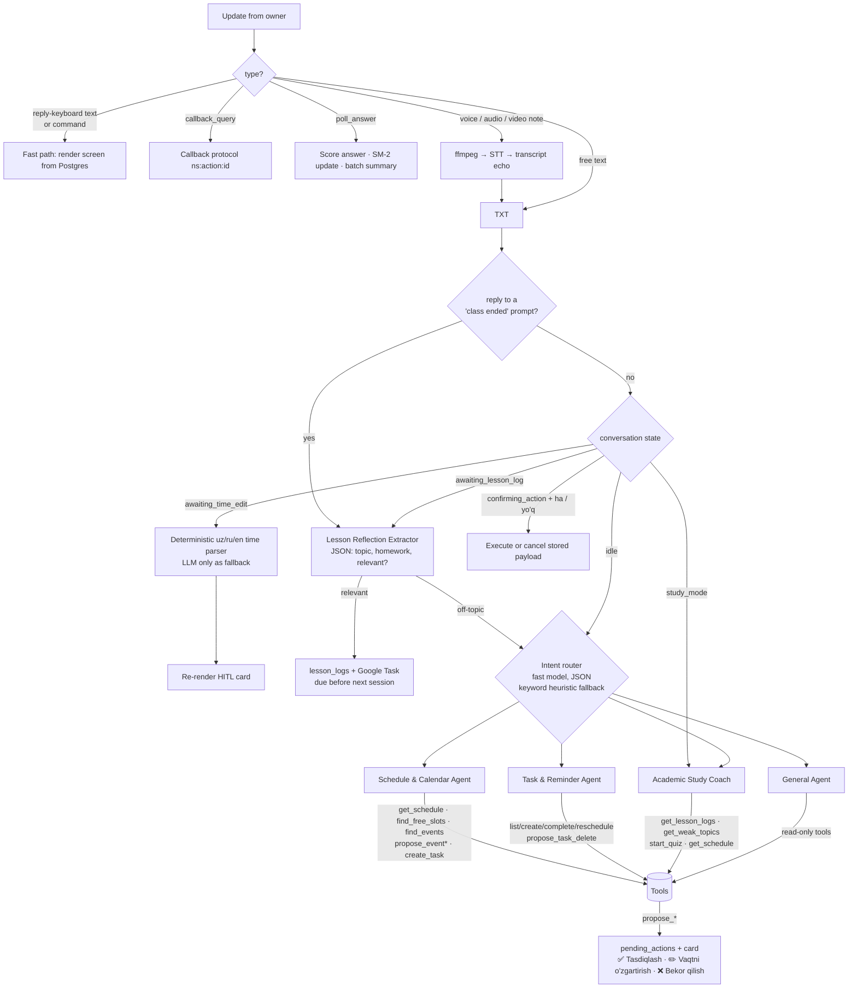
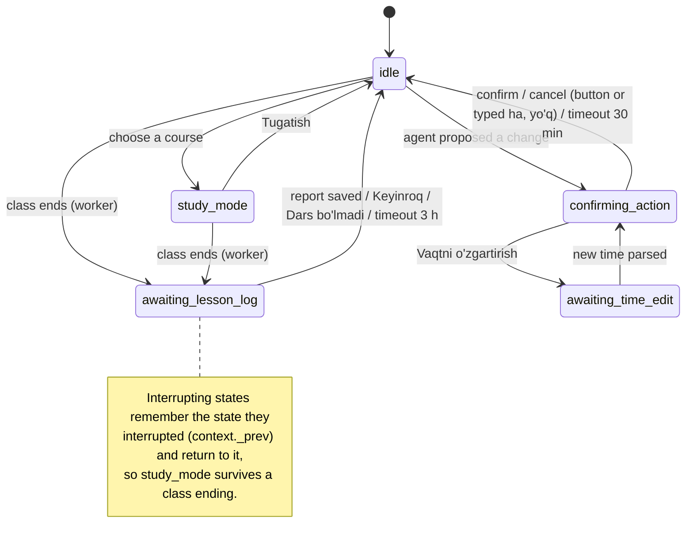

# Memora OS — Architecture & Tech Stack Blueprint (Phase 1)

Single-tenant, proactive, multi-agent Telegram system for one PDP University student
(`Asia/Tashkent`, UTC+05:00). Everything the bot says is Uzbek (Latin); it understands
Uzbek (Latin + Cyrillic), Russian and English.

---

## 1. Tech stack

| Layer | Choice | Why this and not something else |
|---|---|---|
| Language / runtime | **Python 3.13, asyncio** | Best ecosystem for Telegram + LLM tooling; one event loop handles polling, agents and schedulers without threads. |
| Telegram | **aiogram 3** (long polling) | Typed, async, middleware-first. Long polling needs no public domain or TLS certificate on a student VPS; updates are handled as concurrent tasks. |
| Persistence | **PostgreSQL 16** via SQLAlchemy 2 (async) + asyncpg | One transactional store for *everything*: timetable, tasks, lesson logs, FSM state, episodic memory, the notification ledger and the HITL queue. |
| Migrations | **Alembic** | Versioned schema; one-shot `migrate` service in compose. |
| Scheduler | **Stateless tick loop** (every 20 s, wall-clock aligned) + Postgres dispatch ledger | See §6. No in-memory job store to lose on restart, no cron drift. |
| Queue / cache | **Postgres** (outbox flag, `UNIQUE` dedupe keys, advisory lock) — *no Redis* | With one user, Redis would add a second stateful service and a second source of truth for no throughput benefit. Uniqueness constraints and transactions give stronger guarantees than a cache. If this ever becomes multi-tenant, the ledger/outbox tables are already the right seams to put a broker behind. |
| LLM access | **OpenAI-compatible Chat Completions** over httpx, provider-agnostic | One protocol reaches Gemini, OpenAI, Groq, OpenRouter or a self-hosted gateway. Chains like `gemini/gemini-3.8-flash → gemini/gemini-3.6-flash → groq/…` are pure configuration. |
| Default models | Gemini Flash (agents), Flash-Lite (router/extraction) | Free tier, strong Uzbek, native audio. Model ids are env settings because they change every few months. |
| Speech-to-text | ffmpeg → MP3 → Gemini native audio, fallback Groq/OpenAI Whisper-style endpoint | Telegram voice is OGG/Opus; normalising first makes every backend usable. |
| Google | Raw REST (Calendar v3, Tasks v1) with OAuth refresh token | Async, tiny, no heavyweight SDK. A personal Gmail cannot delegate Tasks to a service account, so user OAuth is the only option. |
| Deployment | Docker Compose: `db`, `migrate`, `bot`, `worker` | Bot and worker are the same image; either can restart without the other. |
| Observability | JSON logs, `/status`, heartbeats + container healthchecks, rate-limited diagnostic alerts to the owner chat | |

---

## 2. System architecture

```mermaid
flowchart LR
    U([Maxmanazar<br/>Telegram chat 812304675])

    TG[[Telegram Bot API]]

    subgraph BOT[bot container — interactive path]
        MW[OwnerOnly middleware<br/>whitelist at update level]
        FAST[Fast path<br/>reply keyboard + callbacks<br/>deterministic, no LLM]
        FSM[State machine<br/>+ flows]
        ORCH[Router → specialised agents<br/>tool-calling loop]
        STT[Voice pipeline<br/>ffmpeg → STT]
    end

    subgraph WORKER[worker container — proactive path]
        LOCK[Leader lock<br/>pg advisory lock]
        TICK[tick every 20 s<br/>briefing · T-15 · class end<br/>reminders · weekly · review]
        SYNCT[Timetable sync<br/>fetch → parse → diff → alert]
        SYNCG[Google sync<br/>task outbox push · pull · calendar cache]
    end

    subgraph PG[(PostgreSQL)]
        D1[timetable · courses · class_sessions · lesson_logs]
        D2[tasks · calendar_events · pending_actions]
        D3[conversation_state · memory_messages]
        D4[notifications ledger · kv]
        D5[quiz_items · quiz_attempts · quiz_polls · study_sessions]
    end

    LLM[[LLM providers<br/>fallback chain]]
    GOOGLE[[Google Calendar<br/>Google Tasks]]
    SHEETS[[University timetable<br/>Google Sheets CSV]]

    U <--> TG
    TG -->|updates| MW --> FAST & FSM
    FSM --> ORCH
    MW --> STT --> FSM
    FAST --> PG
    FSM --> PG
    ORCH --> PG
    ORCH <--> LLM
    STT <--> LLM
    ORCH <--> GOOGLE
    TICK --> PG
    TICK -->|dispatch_once| TG
    SYNCT --> SHEETS
    SYNCT --> PG
    SYNCG <--> GOOGLE
    SYNCG --> PG
    BOT -->|replies| TG
    LOCK -.-> TICK
```

Two processes, one database. The **bot** only reacts to updates; the **worker** only acts
on time. They coordinate exclusively through Postgres rows (for example, the worker sets
`conversation_state = awaiting_lesson_log` and the bot reads it on the next message), so
neither needs the other to be up.

---

## 3. Request routing and multi-agent topology



Design rules that make this safe:

* **Agents propose, buttons dispose.** Calendar create/update/delete and task deletion
  only write a `pending_actions` row. The confirmation card is rendered by code from that
  row (including conflict warnings against both Google Calendar *and* university classes),
  and the button executes the stored payload. The LLM is not involved at execution time,
  and its prose is suppressed whenever a card/receipt already says what happened.
* **Each agent has its own episodic memory domain** (`memory_messages.domain`), the last
  8 messages within 6 hours, so a study conversation never pollutes calendar reasoning.
* **Long-term academic memory is structured**, not chat history: `lesson_logs`, quiz
  results and the timetable are exposed to the Study Coach through tools.
* **Relative time is resolved against an explicit date table** injected into every prompt
  (`2026-11-18 = chorshanba (ertaga)` …) rather than left to model arithmetic.

### Conversation state machine



---

## 4. Database schema

```mermaid
erDiagram
    courses ||--o{ timetable_entries : "has slots"
    courses ||--o{ class_sessions : "has"
    courses ||--o{ lesson_logs : "has"
    courses ||--o{ quiz_items : "has"
    courses ||--o{ study_sessions : "has"
    courses ||--o{ tasks : "homework for"
    timetable_entries ||--o{ class_sessions : "occurs as"
    class_sessions ||--o| lesson_logs : "logged by"
    lesson_logs }o--o| tasks : "homework task"
    lesson_logs ||--o{ quiz_items : "source of"
    quiz_items ||--o{ quiz_attempts : "has"
    quiz_items ||--o{ quiz_polls : "sent as"

    courses {
        int id PK
        string group_key
        string key
        string title
    }
    timetable_entries {
        int id PK
        string group_key
        int weekday
        int slot_no
        time start_time
        time end_time
        string subject
        string kind
        string room
        string teacher
        string shared_groups
        bool is_active
        string content_hash
    }
    timetable_changes {
        int id PK
        timestamptz detected_at
        string change_type
        jsonb before
        jsonb after
    }
    class_sessions {
        int id PK
        int entry_id FK
        date class_date
        timestamptz starts_at
        timestamptz ends_at
        string status
        bigint prompt_message_id
    }
    lesson_logs {
        int id PK
        int course_id FK
        int session_id FK
        date class_date
        text topic
        text homework
        text raw_text
        string input_kind
        int task_id FK
    }
    tasks {
        int id PK
        string google_task_id UK
        string title
        timestamptz due_at
        bool has_time
        timestamptz remind_at
        timestamptz reminded_at
        string status
        string source
        bool needs_push
    }
    calendar_events {
        string google_event_id PK
        string summary
        timestamptz starts_at
        timestamptz ends_at
        bool all_day
    }
    pending_actions {
        string id PK
        string kind
        jsonb payload
        string status
        timestamptz expires_at
    }
    conversation_state {
        bigint chat_id PK
        string state
        jsonb context
        timestamptz expires_at
    }
    memory_messages {
        int id PK
        string domain
        string role
        text content
    }
    notifications {
        int id PK
        string dedupe_key UK
        string kind
        string status
        int attempts
    }
    quiz_items {
        int id PK
        string topic
        string question
        jsonb options
        int correct_index
        float ease
        int interval_days
        int repetitions
        int lapses
        timestamptz due_at
    }
    quiz_attempts {
        int id PK
        int item_id FK
        string mode
        bool correct
    }
    quiz_polls {
        string poll_id PK
        int item_id FK
        string batch_id
        bool answered
    }
    study_sessions {
        int id PK
        int course_id FK
        timestamptz started_at
        timestamptz ended_at
        int turns
    }
    kv {
        string key PK
        jsonb value
    }
```



The authoritative definition is `memora/db/models.py`; `migrations/versions/0001_initial_schema.py`
creates it (verified with `alembic check`: no drift).

Notes on the non-obvious columns:

* `timetable_entries` is unique on `(group_key, weekday, start_time)` — a slot's identity.
  A slot whose content changes is updated in place (stable id for buttons and dedupe
  keys); a slot that disappears is soft-deleted (`is_active = false`).
* `courses.key` strips the `(Lecture)` / `(Practice)` suffix, so "the next session of that
  subject" for homework means the next lecture **or** practice of the same course.
* `tasks.remind_at` holds the exact ISO-8601 `+05:00` reminder instant. **Google Tasks
  silently discards the time part of `due`**, so the time can only live here (it is also
  written into the Google task's notes as `⏰ Eslatma: 2026-11-18T19:00:00+05:00`).
  `reminded_at < remind_at` means "this reminder time has not fired yet", which is what
  makes snoozing a one-column update.
* `tasks.needs_push` is the outbox flag for Google.
* `notifications.dedupe_key` is the idempotency ledger (§6).

---

## 5. Telegram UX

**Persistent reply keyboard** (fast path, no LLM, 4–20 ms server-side in the test-suite):

```
[ 📅 Bugungi jadval ] [ 📆 Ertangi jadval ]
[ 📋 Vazifalarim    ] [ 📖 O'qish rejimi  ]
[ 📊 Haftalik hisobot                     ]
```

**Commands:** `/start` `/help` `/status` `/sync` `/darslar` `/pauza [kun]` `/davom` `/cancel`

**Callback state protocol** — `callback_data = <ns>:<action>[:<id>…]`, ASCII, ≤ 64 bytes,
ids only (never text), so every button survives restarts and is handled deterministically:

| ns | actions | Meaning |
|---|---|---|
| `m` | `today` `tomorrow` `tasks` `study` `week` `pending` `review` | menu screens |
| `t` | `done:<task>` `snz:<task>:<min>` `del:<task>` `undo:<task>` | ✅ Bajarildi · ⏰ +15 daqiqa / +1 soat · 🗑 · ↩️ |
| `a` | `ok:<action>` `edit:<action>` `no:<action>` | ✅ Tasdiqlash · ✏️ Vaqtni o'zgartirish · ❌ Bekor qilish |
| `c` | `prep:<entry>` `quiz:<course>` | 📝 Darsga tayyorgarlik · 🧠 Tezkor test |
| `l` | `log:<session>` `later:<session>` `none:<session>` | lesson reflection |
| `s` | `course:<course\|0>` `plan` `quiz` `cards` `exit` | study mode |
| `f` | `show:<item>` `rate:<item>:<0\|1>` `stop` | flashcards |

**Proactive messages**

| When | Message | Buttons |
|---|---|---|
| 07:30 daily | ☀️ briefing: classes of both cohorts, calendar events, due + overdue tasks, unlogged classes, cards due | 📋 · 📆 · 📝 Yozilmagan darslar · 🧠 Takrorlash · 📖 |
| T-15 before each class | 🔔 subject, time, room, teacher, group | 📝 Darsga tayyorgarlik |
| Minute a class ends | ✅ "… darsi tugadi. Qaysi mavzu o'tildi, uy vazifasi berildimi?" → `awaiting_lesson_log` | ⏭ Keyinroq · 🚫 Dars bo'lmadi |
| Task `remind_at` | ⏰ reminder | ✅ Bajarildi · ⏰ +15 daqiqa · ⏰ +1 soat |
| Timetable changed | 🔔 added / removed / changed slots, flags changes hitting today or tomorrow | — |
| 19:30 if ≥ 3 cards due | 🧠 spaced-repetition nudge | 🧠 Test bilan · 🃏 Kartochkalar |
| Sunday 20:00 | 📊 weekly digest: logged classes, tasks done vs pending, study time, quiz accuracy, weak topics, tips | — |

Double periods (two consecutive slots of the same course, which this timetable has on
Tuesday and Friday) get a T-15 alert per slot — the room changes — but **one** reflection
prompt, after the last slot.

---

## 6. Resilience design

### Idempotent scheduling

`tick()` is a pure function of *(database, now)*. Every run recomputes what should have
been sent by now and passes each candidate to `dispatch_once(key, …)`:

1. `INSERT … ON CONFLICT (dedupe_key) DO NOTHING RETURNING id` — committed first.
2. Only the inserter sends. A crash between 1 and 2 loses that one message (at-most-once)
   but can never duplicate it; a restart re-runs the same computation and hits the
   conflict.
3. A send that raised is marked `failed` and retried with quadratic backoff
   (30 s, 2 min, 4.5 min, 8 min, 12.5 min), which rides out short Telegram outages.

Keys: `briefing:<date>`, `class_alert:<date>:<entry>`, `class_end:<date>:<entry>`,
`task:<id>:<remind_at epoch>`, `weekly:<iso-week>`, `review:<date>`.

Because the computation is window-based, downtime is caught up: a briefing missed at
07:30 is still sent until noon, a T-15 alert is sent late as long as the class has not
started, and a class-end prompt within 90 minutes.

A Postgres **advisory lock** elects one scheduler if two workers are ever started.

### Google outages

Task writes are local-first with `needs_push = true`; the worker flushes the outbox every
few minutes, each task in isolation (so one failure cannot roll back another task's
successful push and create it twice). Calendar reads fall back to the local cache. A
failed calendar *write* leaves the HITL card pending with a clear message — nothing is
half-applied.

### LLM outages

Per route: retry 429/5xx/timeouts with exponential backoff + jitter, honour short
`Retry-After`; then fall through the chain; exhausted routes cool down for 60 s. If
every route is down: the router falls back to keyword heuristics, lesson reports are
stored verbatim rather than lost, the user gets one honest Uzbek message, and the fast
path, schedules and reminders keep working because none of them touch a model.

### Timetable safety

A tab that fails to download, returns HTML (sharing switched off) or no longer parses is
skipped and reported; a cohort that is missing from the sheet is reported and **its
stored schedule is kept**. Only groups actually found in a successfully parsed tab are
diffed.

### Output safety

Models write a small Markdown subset; `textfmt.py` converts it to Telegram HTML by
escaping everything and emitting tags itself, splits at 4096 characters without cutting
code blocks, and falls back to plain text if Telegram ever rejects entities. Quiz polls
are sent with no parse mode at all.

### Security

The whitelist is an *outer middleware on the root update observer*: both the sender and
the chat must equal `812304675`, checked before filters, handlers, FSM or any LLM call.
Other updates are dropped silently. Secrets live only in `.env`.

---

## 7. What the real timetable looks like (verified against the live sheet)

The export is not multi-line cells. Each group is a **4-row block** — subject / teacher /
room / shared groups — with the group name only on the first row; the degree tab has 8
slots per day and the English tab 7; group names carry a suffix (`25-408 (UZ)`); there is
at least one whitespace-only cell. The parser derives the column map from the header rows
instead of assuming a shape, flattens "all lines of all rows of a block" per column, and
classifies lines by content, so it handles both this layout and true multi-line cells.
`tests/fixtures/` reproduces the real rows for both cohorts.

Current result: 12 weekly classes for `25-408` (Mon, Tue, Thu, Fri) and 2 for
`Intermediate 13` (Mon and Thu 11:00, room 229), with no overlaps between the cohorts.

---

## 8. Known limits and deliberate trade-offs

* **At-most-once on crash.** A process killed in the instant between claiming and sending
  loses that single alert. The alternative (at-least-once) is what produces duplicates.
* **Timetable is treated as weekly.** The sheet has no dates, so holidays are not known;
  `/pauza N` mutes class alerts and briefings for N days (task reminders continue).
* **Google OAuth "Testing" apps expire refresh tokens after 7 days.** Publish the OAuth
  consent screen to *Production* (no verification needed for personal use) — see README.
* **Quiz content is LLM-generated** from your own lesson logs; a wrong "correct answer" is
  possible. Questions are validated structurally (4 distinct options, bounds, shuffled),
  not factually.
* **Single-tenant by design.** Tables carry no user id. Going multi-user means adding one
  column and a tenant filter, not re-architecting, but it is not built.
